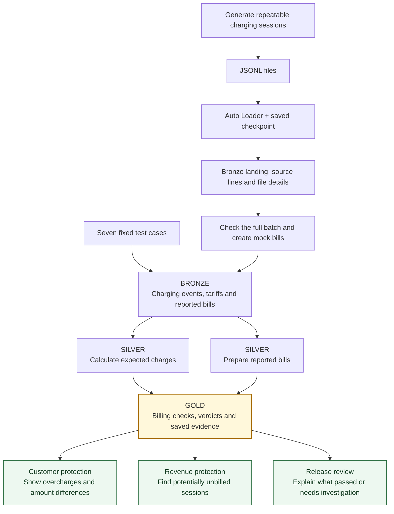

# ChargeAssert

**ChargeAssert helps EV charging teams catch billing errors before a software release overcharges customers or leaves completed sessions unbilled.**

A working MVP built with simulated charging data, **Databricks, Delta Lake, Auto Loader, Python and SQL**. It compares reported bills with what each session should cost, then saves a clear result and the evidence behind it.

[Business value](#why-it-matters) · [Architecture](#architecture) · [Run the demo](#run-the-billing-demo) · [Project status](#current-status-and-next-steps)

## Why it matters

A charging session can finish successfully while its bill is wrong. A software change might use the wrong price, charge too much or produce no bill at all. A successful data job alone does not prove that billing is correct.

ChargeAssert helps teams answer three questions before a release:

| Business question | What ChargeAssert shows |
| --- | --- |
| Could customers be overcharged? | The expected charge, reported charge and difference. |
| Could completed sessions go unbilled? | Whether each completed test session has exactly one final billing record. |
| Can we explain a failure? | The failed check, source records and saved result for that job run. |

Engineers can trace a problem to its inputs. Billing teams can see the amount at stake. Release owners can use the evidence to decide whether a change needs investigation. Automating that release check is a future step.

### A concrete example

A test session delivers **12.5 kWh at EUR 0.45/kWh**. Its expected charge is **EUR 5.63**, rounded once at the session total, excluding VAT.

| Billing version | Expected | Reported | Difference | Result |
| --- | ---: | ---: | ---: | --- |
| Healthy baseline | EUR 5.63 | EUR 5.63 | EUR 0.00 | PASS |
| Candidate with a billing error | EUR 5.63 | EUR 6.50 | +EUR 0.87 | FAIL |
| Corrected candidate | EUR 5.63 | EUR 5.63 | EUR 0.00 | PASS |

Another test deliberately leaves out the final bill. ChargeAssert flags the missing record and keeps the expected charge visible, helping show what could go unbilled. It does not treat a missing bill as a zero charge.

These are controlled examples using simulated data, not measured customer losses or savings.

## How it works

1. **Keep the inputs.** Store charging events, tariffs and reported bills so each result can be traced back to its source.
2. **Work out the expected charge.** SQL uses the session's meter readings and tariff to calculate what should have been billed.
3. **Compare the bills.** Check both billing versions against that calculation.
4. **Save the evidence.** Keep each check's result and a separate saved copy for each completed job run.

The **baseline** is the healthy billing version; the **candidate** is the version being tested. Both currently use Python mocks or saved responses. The expected charge is calculated separately in SQL, so an error shared by both versions should still be caught.

Charging events follow an OCPP-shaped format; bills follow an OCPI-shaped format. A **CDR**, or charge detail record, describes a session's usage and charge. Full protocol certification is outside the current scope.

## Architecture

Databricks runs the jobs, Delta Lake stores the data, and Unity Catalog groups it into Bronze, Silver and Gold. The fixed test cases and newly generated sessions use separate tables, so new batches do not change the original demo results.



| Layer | Purpose | Main records |
| --- | --- | --- |
| **Bronze** | Keep the original evidence. | Events, tariffs, bills, source-file details and job status. |
| **Silver** | Make the records ready to compare. | Sessions, tariff history, expected charges and reported charges. |
| **Gold** | Give teams billing results they can act on. | Amount differences, missing-bill checks, verdicts and saved evidence. |

**Gold connects the pipeline to business decisions.** It gives billing teams the charge difference, operations teams a list of sessions with missing bills, and release owners a result they can investigate. It supports human review today; automatic GitHub release checks are planned.

See the [table guide](docs/01-tables.md) for each table's role and the [runbook](docs/02-runbook.md) for the detailed rules.

### What makes a result trustworthy

- **Separate calculations:** bills are checked against an independent SQL calculation, using decimals and a clear rounding rule.
- **Full coverage:** every session needs seven checks for each version: expected charge available, bill count, energy, duration, currency, tariff and amount.
- **Traceable inputs:** original records, hashes and expected-versus-reported values help explain a failure.
- **Results tied to a run:** a failed or incomplete attempt must not use an older PASS as its result.

The current billing tables and saved execution results serve different purposes. To confirm a run, check its own completion record and saved result together. The verification queries below do that.

## Run the billing demo

### Requirements

- A Databricks workspace with Unity Catalog, a SQL warehouse and serverless job compute.
- Databricks CLI **0.295.0 or newer**, authenticated to the workspace.
- Permission to create schemas, a managed Volume, tables and jobs, and to use the compute.

The defaults in [databricks.yml](databricks.yml) use the `workspace` catalog and a warehouse called `Serverless Starter Warehouse`. Adjust these if your workspace differs.

### Deploy and run

Run from the repository folder, one command at a time. Continue only after the previous command succeeds.

```bash
git switch dev
git pull --ff-only origin dev
databricks bundle validate -t dev
databricks bundle deploy -t dev
databricks bundle run -t dev create_tables
```

Despite its name, `create_tables` runs the full fixed demo: it creates the tables, loads inputs, generates mock bills, checks them and saves the results. Pulling Git changes alone does not update the deployed job.

The demo has **seven fixed test cases and 98 checks**. These cover healthy billing, wrong amounts and missing bills, along with their corrected versions.

**Job success and billing success are different.** A job should succeed when it correctly detects and records a deliberately wrong bill. That bill's result should still be FAIL.

### Check the result

Find the run you just started in the Databricks SQL editor:

```sql
SELECT execution_id, started_at, status, reason
FROM workspace.chargeassert_dev_bronze.job_execution
ORDER BY started_at DESC
LIMIT 20;
```

Use its exact `execution_id` with [the execution check](sql/12_check_execution.sql). The [runbook](docs/02-runbook.md#check-the-requested-execution) explains the required parameters.

| Amount test | Baseline | Candidate | Overall | Passed / failed |
| --- | --- | --- | --- | --- |
| Wrong amount | PASS | FAIL | FAIL | 13 / 1 |
| Corrected amount | PASS | PASS | PASS | 14 / 0 |

Also confirm that the Databricks job finished successfully. The verification query returns BLOCKED for missing, failed or incomplete runs. After a failed attempt, start a new full run; the current tracking does not support job repairs.

## Run the file ingestion demo

After deployment, publish a sample file and load it into Bronze:

```bash
databricks bundle run -t dev publish_ingestion_demo --params batch=batch_001
databricks bundle run -t dev ingest_ocpp_files
```

Auto Loader remembers processed files through its saved checkpoint. The demo checks that loading the same files again does not add rows: the two sample files should follow **3 → 3 → 6 → 6** as they are published and ingestion is repeated.

The [ingestion walkthrough](docs/02-runbook.md#incremental-ocpp-file-ingestion) has the full sequence and [SQL checks](sql/13_check_ocpp_ingestion.sql). Keep the source files and checkpoint unchanged when testing repeat runs.

## Generate sessions and check their bills

The [generated-session guide](docs/03-generated-sessions.md) covers this path from start to finish, including a simple Gold query.

After deployment, run the whole pipeline with its defaults: **100 simulated sessions**, seed `42` and deliberately incorrect candidate bills. It picks a new batch name automatically:

```bash
databricks bundle run -t dev run_generated_pipeline
```

This parent job generates 300 charging events, loads them with Auto Loader and checks both mock billing versions through Silver and Gold. Each step waits for the previous one to succeed. The candidate adds EUR 0.87 to every bill. Expect **1,300 PASS and 100 FAIL checks**: baseline PASS, candidate FAIL and overall FAIL. The job itself should succeed because it detected and saved the billing errors.

To check correct candidate bills instead:

```bash
databricks bundle run -t dev run_generated_pipeline --params candidate_mode=healthy
```

Expect **1,400 PASS checks** and all verdicts PASS. Use `--params session_count=10` for a smaller batch, or `--params candidate_mode=healthy,session_count=10` to change both settings. Add `,seed=123` to change the usage values. Each new run creates new session IDs and stops when finished. To check the same sessions again, use an explicit `batch_id`; the [guide](docs/03-generated-sessions.md) shows how.

Open the parent run's `evaluate_generated_batch` child job and use the `execution_id` from its notebook output with [the generated execution check](sql/15_check_generated_billing.sql).

## Local tests

```bash
python -B -m unittest discover -s tests -q
```

**222 local tests pass.** They cover generation, validation, billing, verdicts, session coverage and saved results. Some use substitutes for Databricks and Spark, so workspace checks are still needed for deployment, repeat runs and recovery.

## Current status and next steps

This is a working portfolio MVP using simulated data and a flat energy rate. It does not process real payments or yet test real software release builds.

**Confirmed in Databricks:** the original correct/wrong-amount examples, an execution with seven saved test results, and a generated Gold result with **2 sessions, 28 checks and all verdicts PASS**. The [generated-session guide](docs/03-generated-sessions.md#confirmed-result) records that result.

**Still to check:** the new parent workflow, the generated job's completion record, its deliberate-error test, stable repeat runs, recovery after interruption and the original missing-bill results.

Next steps are to finish those checks, support more incoming data and billing cases, test real releases, and add GitHub release checks. Runtime, cost and throughput measurements are also planned. The [remaining-work list](docs/02-runbook.md#remaining-mvp-work) tracks the details.

## Repository guide

| Location | What it contains |
| --- | --- |
| [MVP brief](docs/OVERVIEW.pdf) | Business problem and original planned scope. |
| [Table guide](docs/01-tables.md) | What each table does and why it matters. |
| [Runbook](docs/02-runbook.md) | Setup, data rules, verification and remaining work. |
| [Generated-session guide](docs/03-generated-sessions.md) | Commands, expected results and a simple Gold query. |
| [databricks.yml](databricks.yml) and [resources/](resources/) | Bundle configuration, schemas, Volume and jobs. |
| [sql/](sql/) | Table definitions, billing calculations and checks. |
| [notebooks/](notebooks/) | Session generation, mock billing, ingestion and execution tracking. |
| [data/ingestion_demo/](data/ingestion_demo/) | Sample files for the ingestion demo. |
| [tests/](tests/) | Local automated tests. |

The PDF describes the intended MVP scope. The guides distinguish what is built, what has been checked and what remains.
