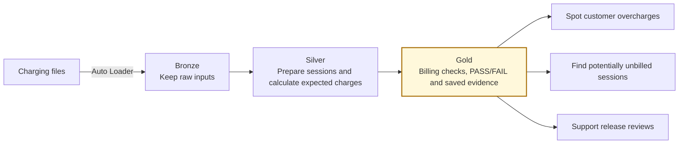

# ChargeAssert

**ChargeAssert helps EV charging teams catch wrong or missing bills before a software release affects customers.**

It compares reported bills with an independent calculation of what each charging session should cost, then saves a PASS or FAIL with the evidence behind it.

Built with **Databricks, Delta Lake, Auto Loader, Python and SQL**. Jobs and infrastructure are defined in Databricks bundles.

## A simple example

A session delivers **12.5 kWh at EUR 0.45/kWh**. The expected charge is **EUR 5.63**, rounded to cents and excluding VAT.

| Reported bill | Result | Why it matters |
| --- | --- | --- |
| EUR 5.63 | PASS | The charge is correct. |
| EUR 6.50 | FAIL | The customer would be overcharged by EUR 0.87. |
| No bill | FAIL | A completed session could go unbilled. |

These are simulated examples, not actual customer charges.

## How it works



The pipeline checks two simulated billing versions against the same SQL calculation. Raw events, tariffs and bills remain available to explain any difference.

- **Repeatable inputs:** generate charging sessions and load new files with Auto Loader.
- **Independent checks:** compare bills against expected amounts, usage, currency and tariff.
- **Saved evidence:** keep results for each job attempt so earlier results remain available.

## Current progress

The MVP includes seven fixed test scenarios and a path for newly generated sessions through Gold. A recorded Databricks result shows **2 generated sessions, 28 checks and PASS for both billing versions and overall**.

There are **216 passing local tests**. Some use substitutes for Databricks and Spark, so they do not replace workspace testing.

Billing currently uses synthetic data and Python mocks. The next checks cover the generated job's completion record, deliberate billing errors, repeat runs and recovery. Testing real software releases and adding GitHub release checks come later.

## Try it and explore

Start with the **[generated-session guide](docs/03-generated-sessions.md)** for the commands, expected results and simple Gold query. Each job runs on demand and stops when finished.

| Document | What you will find |
| --- | --- |
| [Generated sessions](docs/03-generated-sessions.md) | Run the demo and check the results. |
| [Table guide](docs/01-tables.md) | What each Bronze, Silver and Gold table does. |
| [Runbook](docs/02-runbook.md) | Setup, detailed rules, troubleshooting and remaining work. |
| [Original MVP brief](docs/OVERVIEW.pdf) | The business problem and planned scope. |

The code is in [notebooks/](notebooks/), the transformations in [sql/](sql/), and the job definitions in [resources/](resources/).

Run the local tests with:

```bash
python -B -m unittest discover -s tests -q
```
