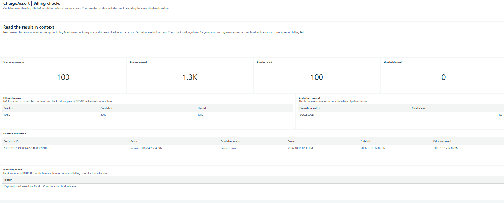

# 05 — Run ChargeAssert and read the results in Databricks

Use this dashboard to review saved billing checks without writing SQL. To launch a simulation, use the [ChargeAssert app](06-simulation-app.md) or the Lakeflow job below.



*Screenshot taken before the logo was added. Live `amount_error` result on 2026-10-15: evaluation succeeded, baseline billing passed, and the deliberately incorrect candidate bills failed.*

## Deploy once after pulling changes

From the ChargeAssert folder in the Databricks terminal, run each command in order:

```bash
git switch dev
git pull --ff-only origin dev
databricks bundle validate -t dev
databricks bundle deploy -t dev
databricks bundle summary -t dev
```

The summary includes these resources:

- **Job:** `chargeassert_dev_run_generated_pipeline`
- **Dashboard:** `ChargeAssert - Generated billing results (dev)`

The bundle creates and publishes the dashboard automatically, using the existing catalog and SQL warehouse. No manual dashboard setup is needed. Pull and deploy again when the code changes; normal simulation runs need neither command.

## Run a simulation

Open **Jobs & Pipelines**, select `chargeassert_dev_run_generated_pipeline` and click **Run now**. The defaults create 100 sessions with deliberately incorrect candidate bills. The dropdown beside Run now lets you change `session_count`, `seed` or `candidate_mode`.

You can also start the same job from the terminal:

```bash
databricks bundle run -t dev run_generated_pipeline
```

Generation and ingestion run first. The evaluation job then checks the bills and refreshes the dashboard. Wait for the whole job to finish, including its dashboard refresh.

## Read the dashboard

Open the dashboard from the bundle summary or the Databricks dashboard list. From the app, open **View check & run details**, note the **Evaluation** ID, then click **Full dashboard**. Set the dashboard's **Evaluation** filter to that ID so you're reading the same run.

- **Overview:** session and check counts, baseline and candidate billing verdicts, evaluation status, batch name, time and any failure reason.
- **Session bills:** expected and actual charges, their difference, and the checks for each session and billing version.

With the defaults, expect **100 sessions, 1,400 checks, 1,300 PASS and 100 FAIL**. Baseline billing passes; candidate and overall billing fail because each candidate bill is EUR 0.87 too high. The job should still succeed: it caught and saved the intended errors.

Choose `candidate_mode=healthy` for correct bills. With 100 sessions, all 1,400 checks should pass.

## Which run do the results describe?

The evaluation notebook saves its execution ID as a task value, and the refresh task uses that exact ID. Refresh runs when evaluation completes successfully, even when its billing verdict is FAIL. A processing error skips automatic refresh and keeps the job failed. In that case, refresh the dashboard manually and select the failed attempt. Missing, failed or incomplete evaluations show **BLOCKED**, with empty financial counts rather than an older passing result. Saved session details come from that attempt's immutable snapshot.

The default `latest` means the newest evaluation attempt, including failed ones. It can change while you browse. Selecting an exact ID keeps **Overview** and **Session bills** on the same attempt. If you started the job outside the app, the ID is also in the evaluation notebook output.

The evaluation status does not cover the earlier generation and ingestion steps. Those can fail before an evaluator record exists. Check the parent job's status in **Jobs & Pipelines** for the outcome of the whole pipeline. If dashboard refresh itself fails, the job reports that failure; saved billing evidence remains available.

Before the first evaluation creates its tables, dashboard queries cannot return results. Run the pipeline to populate them. The screenshot above confirms the dashboard renders the expected 100-session result in Databricks. Automatic refresh and failed-run handling still need separate verification.

## What is stored in Git?

- [Dashboard resource](../resources/dashboards.yml): display name, warehouse and catalog settings. Deployment publishes the dashboard without sharing the deployer's data permissions; viewers use their own access.
- [Job definition](../resources/generated_billing.yml): the evaluation and dashboard refresh tasks.
- [ChargeAssert logo](images/chargeassert-logo.png): shared branding for the app and dashboard headers. The dashboard loads the PNG from this repository on GitHub.
- [Dashboard asset](../dashboards/generated_billing.lvdash.json): native dashboard pages, widgets and datasets.
- [Dataset SQL](../sql/dashboard/): selection and checks for saved results. No new tables are added.
- [Build script](../scripts/build_dashboard.py): rebuilds the committed dashboard asset after SQL or layout changes. Users only need to deploy it.

For dashboard development, run `python scripts/build_dashboard.py`, then `python scripts/build_dashboard.py --check`. SQL uses the bundle's configured catalog, so it is not tied to `workspace`.

See the [generated-session guide](04-generated-sessions.md) for terminal commands and the [table guide](02-tables.md) for the data behind the results. Databricks documents [dashboard bundle resources](https://docs.databricks.com/aws/en/dev-tools/bundles/resources#dashboard) and [dashboard refresh tasks](https://docs.databricks.com/aws/en/jobs/tasks/dashboard).
