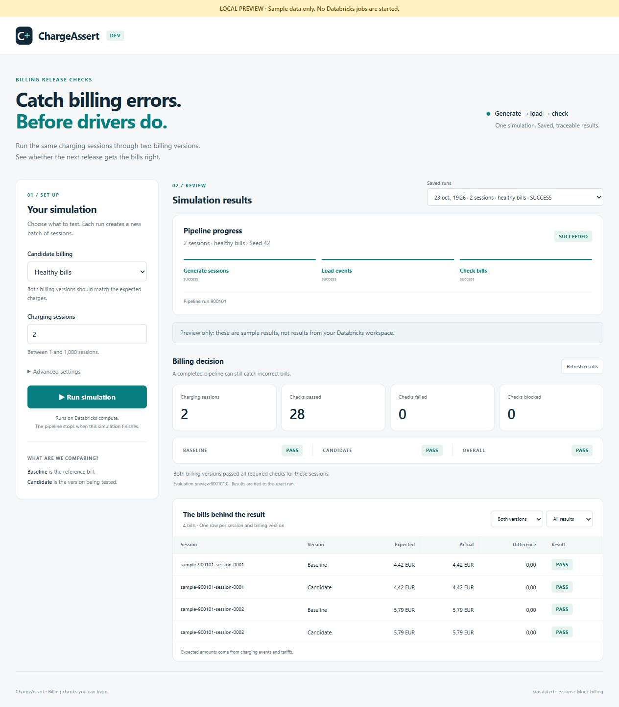

# 06 — Run simulations in the ChargeAssert app

Choose settings, run a simulation and read its billing results on one page. The app uses the existing Lakeflow pipeline and the same saved evidence as the dashboard.



*Local preview with sample data. This is a UI check, not a live Databricks result.*

## Deploy the first version

From your ChargeAssert Git folder in the Databricks terminal, run these commands one at a time:

```bash
git switch dev
git pull --ff-only origin dev
databricks bundle validate -t dev
databricks bundle deploy -t dev
databricks bundle run -t dev setup_simulation_app
databricks bundle run -t dev simulation_app
databricks bundle summary -t dev
```

Open the **simulation_app** URL from the summary, or find **chargeassert-dev-simulation** under **Compute → Apps** in Databricks.

- `deploy` creates the app resource, connects it to the jobs and warehouse, and uploads its code.
- `setup_simulation_app` gives the app read access to the two saved-result tables. Run it once after the app is created, and again if those tables or the app are recreated. It does not change any data.
- `simulation_app` starts the app and deploys its code to app compute. It does not start a simulation.

You need permission to create apps and grant access to the catalog, schemas and result tables. The setup job grants only catalog/schema access and SELECT on `generated_job_execution` and `generated_execution_verdict`.

**New workspace only:** if the setup job says the result tables are missing, create them by running the pipeline once, then repeat the setup and app commands:

```bash
databricks bundle run -t dev run_generated_pipeline --params session_count=2,candidate_mode=healthy
```

For later code updates, pull, validate and deploy the bundle, then run `simulation_app` again.

## Try it

1. Choose **Healthy bills** or **Deliberate overcharges**.
2. Set the session count: **100** by default, from **1 to 1,000**. The optional seed defaults to **42**; the same seed repeats the usage values.
3. Click **Run simulation**. Each new run gets a fresh batch name.
4. Watch generation, ingestion and evaluation finish.
5. Read the billing decision, check counts and session bills below the controls.

For 100 sessions, correct bills should give **1,400 passed checks** and all verdicts PASS. Deliberate overcharges add **EUR 0.87** to every candidate bill: expect **1,300 passed checks, 100 failed checks**, baseline PASS and candidate/overall FAIL.

The recent-runs selector shows up to 20 runs of the same pipeline, including runs started outside the app. The **Open full dashboard** link opens the existing dashboard; use the evaluation ID shown in the app to select the same result there.

## What the status means

**Pipeline status** says whether the whole job finished. **Billing verdict** says whether the bills passed the checks. A successful job can correctly find incorrect bills.

The app resolves the selected parent run to its actual evaluator child run. It never substitutes the newest result from another simulation. Missing or inconsistent evidence stays blocked. Failure before evaluation produces no billing result. If dashboard refresh fails after evaluation, the app can still show saved billing evidence alongside the failed pipeline status.

Start a new full simulation after a failure; repaired attempts are not shown as trusted results. Progress refreshes automatically while the selected run is active. Saved results load after completion and can be refreshed manually. The SQL warehouse may take time to start; retry loading results if it was unavailable.

## Access and running costs

The app uses a Databricks-managed service principal; no personal access token is stored in the code. It can start the existing pipeline, inspect its evaluator, and read the two result tables. The pipeline keeps its existing run identity and permissions.

This version does not automatically share the app with everyone. Anyone you later grant app access can run simulations and see this pipeline's recent runs and saved results. The full dashboard still uses the viewer's own permissions.

App compute is billed while the app runs, separately from job and SQL warehouse compute. Stop the app from its Apps page when you are finished using it.

## Local preview and checks

Install dependencies in a virtual environment, then launch a preview:

```bash
python -m pip install -r app/requirements.txt
python -B app/app.py --preview
```

Open the local URL printed in the terminal. The preview is clearly labelled and uses sample results; it never connects to Databricks. The deployed app uses real jobs and saved results.

```bash
python -B -m unittest discover -s tests
python -B scripts/build_app_assets.py --check
```

If you change the shared dashboard SQL, run `python -B scripts/build_app_assets.py` to update the app's packaged copies, and rebuild the dashboard with `python -B scripts/build_dashboard.py`.

The first version has local checks and a local preview. Live app authentication, permissions and full execution still need verification after deployment.

## Files

| Location | Purpose |
| --- | --- |
| [App code](../app/) | Controls, run progress, history and saved billing results. |
| [App resource](../resources/apps.yml) | App configuration, job/warehouse access and setup job. |
| [Access setup](../notebooks/setup_simulation_app.py) | Grants read access to the two result tables. |
| [Shared SQL](../sql/dashboard/) | The same evidence checks used by the app and dashboard. |

See the [dashboard guide](05-dashboard.md) for the existing dashboard and the [generated-session guide](04-generated-sessions.md) for terminal commands. Databricks documents [app deployment through bundles](https://docs.databricks.com/aws/en/dev-tools/bundles/apps-tutorial) and [app job resources](https://docs.databricks.com/aws/en/dev-tools/databricks-apps/lakeflow).
