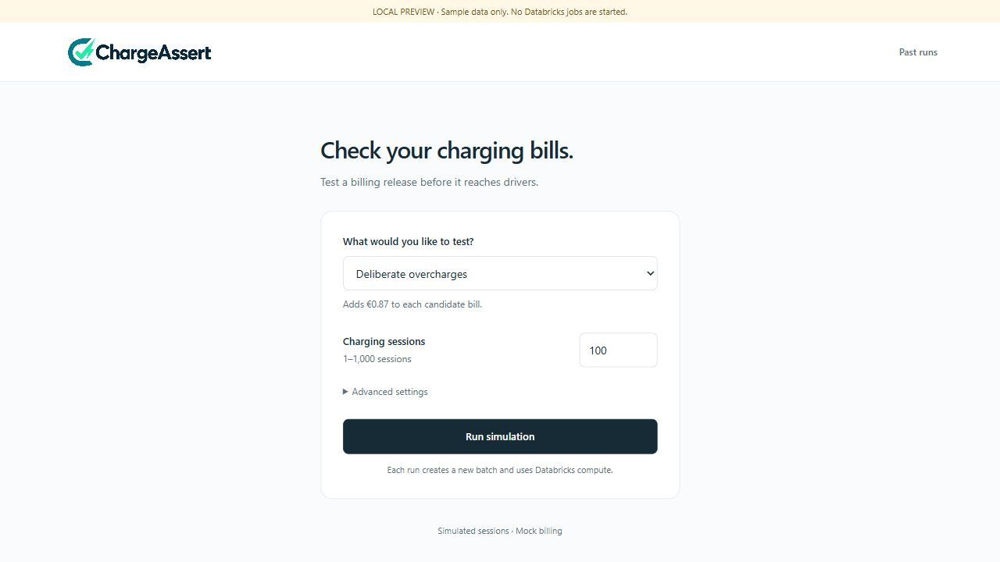
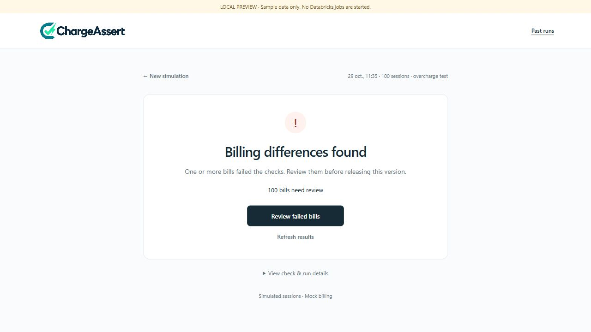

# 06 — Run simulations in the ChargeAssert app

Choose settings, run a simulation, then see its result. Counts, bills and run details open when you need them. The app uses the existing Lakeflow pipeline and the same saved evidence as the dashboard.



*Local preview with sample data. This is a UI check, not a live Databricks result.*

## Deploy or update the app

From your ChargeAssert Git folder in the Databricks terminal, pull the current version and deploy the bundle. You need the [workspace requirements](../README.md#requirements) and permission to create a Databricks App.

```bash
git switch dev
git pull --ff-only origin dev
databricks bundle validate -t dev
databricks bundle deploy -t dev
```

**New workspace only:** if no generated batch has run yet, run this small test first. It creates the result tables the app needs. Wait for it to finish.

```bash
databricks bundle run -t dev run_generated_pipeline --params session_count=2,candidate_mode=healthy
```

**First setup only:** give the app read access to those tables. Repeat this if the app or its result tables are recreated. Skip this step for a normal app update.

```bash
databricks bundle run -t dev setup_simulation_app
```

Then start the updated app and get its URL:

```bash
databricks bundle run -t dev simulation_app
databricks bundle summary -t dev
```

Open the **simulation_app** URL from the summary, or find **chargeassert-dev-simulation** through the **app switcher → Databricks Apps** in Databricks.

Starting the app does not start a simulation. The first setup needs permission to grant catalog and schema access and SELECT on `generated_job_execution` and `generated_execution_verdict`.

## Try it

1. Choose **Healthy bills** or **Deliberate overcharges**.
2. Set the session count: **100** by default, from **1 to 1,000**. Open **Advanced settings** to change the seed (default **42**); the same seed repeats the usage values.
3. Click **Run simulation**. Each new run gets a fresh batch name, and the app moves from setup to the result screen.
4. Wait for the result to update automatically. **Billing differences found** → **Review failed bills** shows only failed bills. **All billing checks passed** → **View bills** shows both versions. Each row gives the expected charge, the reported charge and the difference.
5. Open **View check & run details** for check counts, billing verdicts, progress, IDs and links to the job and full dashboard.

For 100 sessions, correct bills should give **1,400 passed checks** and all verdicts PASS. Deliberate overcharges add **EUR 0.87** to every candidate bill: expect **1,300 passed checks, 100 failed checks**, baseline PASS and candidate/overall FAIL.

**Past runs** opens a dialog with up to 20 runs, including runs started outside the app. **New simulation** returns to setup; it does not stop a run that is still working.

The **Full dashboard** link is inside the run details. Use the evaluation ID shown there to select the same result in the dashboard.



*Local preview with sample data, not a live Databricks result.*

## What the status means

**Pipeline status** says whether the whole job finished. **Billing verdict** says whether the bills passed the checks. A successful job can correctly find incorrect bills.

The app resolves the selected parent run to its actual evaluator child run. It never substitutes the newest result from another simulation. Missing or inconsistent evidence stays blocked. Failure before evaluation produces no billing result. If dashboard refresh fails after evaluation, the app can still show saved billing evidence alongside the failed pipeline status.

If the app cannot confirm that a run started, choose **Retry start request**. It reuses the original request to avoid starting two jobs. If only the results failed to load, **Try again** reads the same run. Start a new simulation if the pipeline itself failed; repaired attempts do not have a trusted result in this app.

## Access and running costs

The app uses a Databricks-managed service principal; no personal access token is stored in the code. It can start the existing pipeline, inspect its evaluator, and read the two result tables. The pipeline keeps its existing run identity and permissions.

This version does not automatically share the app with everyone. Anyone you later grant app access can run simulations and see this pipeline's recent runs and saved results. The full dashboard still uses the viewer's own permissions.

App compute is billed while the app runs, separately from job and SQL warehouse compute. Stop the app from its Apps page when you are finished using it.

## Local preview and checks

Install dependencies in a virtual environment, then launch a preview:

```bash
python -m pip install -r app/requirements.txt
python -B app/app.py --preview
```

Open the local URL printed in the terminal. The preview is clearly labelled and uses sample results; it never connects to Databricks. The deployed app uses real jobs and saved results.

```bash
python -B -m unittest discover -s tests
python -B scripts/build_app_assets.py --check
node --test tests/test_simulation_outcome.js
```

The interface uses plain HTML, CSS and JavaScript with system fonts. It adds no frontend framework or external font downloads.

The app header uses the [ChargeAssert logo](images/chargeassert-logo.png), kept in `docs/images` and packaged with the app.

If you change the shared dashboard SQL or logo, run `python -B scripts/build_app_assets.py` to update the app's packaged copies, and rebuild the dashboard with `python -B scripts/build_dashboard.py`.

The first version has local checks and a local preview. Live app authentication, permissions and full execution still need verification after deployment.

## Files

| Location | Purpose |
| --- | --- |
| [App code](../app/) | Controls, run progress, history and saved billing results. |
| [App resource](../resources/apps.yml) | App configuration, job/warehouse access and setup job. |
| [Access setup](../notebooks/setup_simulation_app.py) | Grants read access to the two result tables. |
| [Shared SQL](../sql/dashboard/) | The same evidence checks used by the app and dashboard. |

See the [dashboard guide](05-dashboard.md) for the existing dashboard and the [generated-session guide](04-generated-sessions.md) for terminal commands. Databricks documents [app deployment through bundles](https://docs.databricks.com/aws/en/dev-tools/bundles/apps-tutorial) and [app job resources](https://docs.databricks.com/aws/en/dev-tools/databricks-apps/lakeflow).
